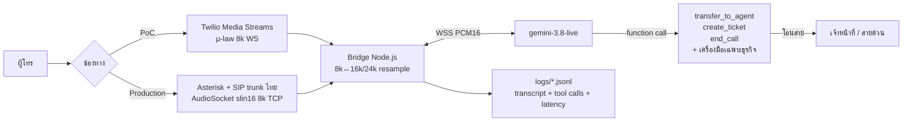

# AILEO Call Center — Gemini 3.8 Live

AI รับสายโทรศัพท์แทนเจ้าหน้าที่ด่านแรก 24 ชม. ตอบคำถามจากฐานความรู้ที่หน่วยงานอนุมัติ
และ **โอนสายหาคนทันที** เมื่อเป็นเหตุด่วน / เรื่องเกินขอบเขต / ระบบ AI ล่ม

โค้ดชุดเดียวรองรับหลายธุรกิจ เลือกบริบทด้วย env `AGENT_PROFILE` (ดูหัวข้อ "บริบทธุรกิจ")
ค่าเริ่มต้นคือ `police` (ศูนย์บริการข้อมูลตำรวจ)



## โครงสร้าง
| ไฟล์ | หน้าที่ |
|---|---|
| `src/server.ts` | HTTP + WebSocket: `/twilio/voice`, `/twilio` (WS), `/next/<callId>`, `/health` และเปิด AudioSocket server |
| `src/agent.ts` | 1 สาย = 1 `CallAgent` = 1 Gemini Live session, tool calls, session resumption, รอพูดจบก่อนโอนสาย |
| `src/prompt.ts` | ประกอบ system prompt จากโปรไฟล์: persona → PDPA → เครื่องมือ → สไตล์พูด → ฐานความรู้ |
| `src/profiles/` | **บริบทธุรกิจ** — `police` / `hospital` / `hotel` / `retail` / `pawnshop` (persona + ฐานความรู้ + เครื่องมือ) |
| `src/kb.ts` | ฐานความรู้ตำรวจ — **ต้องให้หน่วยงานเติม/อนุมัติ** |
| `src/tools.ts` | เครื่องมือกลาง + เครื่องมือเฉพาะธุรกิจ, Function declarations + handler (ต่อ API จริงตรง TODO) |
| `src/twilio.ts` | Adapter Twilio Media Streams (μ-law 8k, PoC) |
| `src/audiosocket.ts` | Adapter Asterisk AudioSocket (slin16 8k, เบอร์ไทยจริง) |
| `src/audio.ts` | G.711 μ-law + resample 8k↔16k/24k (FIR low-pass) + WAV |
| `src/logger.ts` | เขียน `logs/<callId>.jsonl` (transcript, tool, latency, action, error) |
| `src/calls-tail.ts` | `npm run calls:tail` — follow ดูสายล่าสุดแบบเรียลไทม์ |

## บริบทธุรกิจ (Profile)
ตัว agent ไม่ผูกกับธุรกิจใดธุรกิจหนึ่ง เลือกบริบทด้วย env `AGENT_PROFILE`:

| `AGENT_PROFILE` | ธุรกิจ (label) | เครื่องมือเฉพาะ |
|---|---|---|
| `police` (ค่าเริ่มต้น) | ศูนย์บริการข้อมูลตำรวจ | `report_emergency` |
| `hospital` | โรงพยาบาล | `report_emergency`, `book_appointment` |
| `hotel` | โรงแรมและร้านอาหาร | `book_reservation` |
| `retail` | ร้านค้าออนไลน์ | `check_order` |
| `pawnshop` | โรงรับจำนำควิกมันนี่ | `check_pawn_ticket` |

ทุกโปรไฟล์ได้เครื่องมือกลาง `transfer_to_agent`, `create_ticket`, `end_call` อัตโนมัติ

```bash
AGENT_PROFILE=hotel npm run dev          # สลับเป็นบริบทโรงแรม
AGENT_PROFILE=hospital BUSINESS_NAME="รพ.ตัวอย่าง" npm run dev
```

- `BUSINESS_NAME` แทนที่ `{{business}}` ใน persona และฐานความรู้ (ไม่ใส่ = `label` เริ่มต้นของโปรไฟล์)
- `VOICE` เปลี่ยนเสียงของโมเดลได้เหมือนเดิม
- เพิ่มธุรกิจใหม่: สร้างไฟล์ใน `src/profiles/` ตาม `BusinessProfile` แล้วลงทะเบียนใน `src/profiles/index.ts` — ไม่ต้องแตะ `agent.ts`
- `AGENT_PROFILE` ที่ไม่รู้จักจะ fallback เป็น `police` พร้อม log เตือน

## รัน
```bash
cp .env.example .env   # ใส่ GEMINI_API_KEY
npm install
npm run dev            # tsx watch src/server.ts
npm run typecheck      # ตรวจ type
```

- bridge ฟังเฉพาะ `127.0.0.1` เป็นค่าเริ่มต้น (Asterisk อยู่เครื่องเดียวกัน, Twilio เข้าผ่าน reverse proxy) เปลี่ยนได้ด้วย `BIND_HOST`
- env ที่ใช้: `GEMINI_API_KEY`, `GEMINI_MODEL`, `VOICE`, `AGENT_PROFILE`, `BUSINESS_NAME`, `PORT`, `AUDIOSOCKET_PORT`, `LOG_DIR`, `PUBLIC_HOST`, `TWILIO_ACCOUNT_SID`, `TWILIO_AUTH_TOKEN`, `OFFICER_TRANSFER_NUMBER`, `EMERGENCY_TRANSFER_NUMBER`, `ASTERISK_BIND_IP`, `SIP_PASSWORD_1001/2001/2002`, `RECORD_CALLS`, `DEBUG_AUDIO` (คำอธิบายอยู่ใน `.env.example`)

## ทางเลือก A: Twilio (PoC)
1. ตั้ง Voice webhook ของเบอร์เป็น `POST https://PUBLIC_HOST/twilio/voice` (ตอบ TwiML `<Connect><Stream url="wss://PUBLIC_HOST/twilio">`)
2. reverse proxy (Caddy/nginx) ให้ `wss://PUBLIC_HOST/twilio` → `:8080`
3. โอนสายทำผ่าน REST API (`Calls/{sid}.json` + TwiML `<Dial>`) ไปที่ `OFFICER_TRANSFER_NUMBER` / `EMERGENCY_TRANSFER_NUMBER`
4. Production ต้องเพิ่ม validate `X-Twilio-Signature` (ยังไม่มีในโค้ด)

## ทางเลือก B: Asterisk + SIP trunk ไทย (แนะนำสำหรับของจริง)
ต้องใช้ Asterisk 18+ ที่มี `app_audiosocket` และ `func_curl`

dialplan จริงอยู่ใน `docker/asterisk/etc/extensions.conf.tmpl` (entrypoint render `*.tmpl` เป็น `/etc/asterisk/extensions.conf` ตอน start):

```
[globals]
RECORD_CALLS=${RECORD_CALLS}

[internal]
exten => 1599,1,Goto(police-ai,s,1)
exten => 600,1,Answer()
 same => n,Playback(demo-echotest)
 same => n,Echo()
 same => n,Hangup()
exten => 601,1,Answer()
 same => n,Playback(demo-congrats)
 same => n,Playtones(1004/1000,0/500)
 same => n,Wait(5)
 same => n,Hangup()
exten => _200[12],1,Dial(PJSIP/${EXTEN},30)
 same => n,Hangup()

[police-ai]
exten => s,1,Answer()
 same => n,Set(CALLID=${SHELL(tr -d '\n' < /proc/sys/kernel/random/uuid)})
 same => n,ExecIf($["${RECORD_CALLS}" = "1"]?MixMonitor(/recordings/${CALLID}.wav))
 same => n,Set(CURLOPT(conntimeout)=2)
 same => n,Set(CURLOPT(httptimeout)=3)
 ; bridge ล่ม -> AudioSocket() คืน -1 แล้ววางสายทันที จึงเช็ค health ก่อน และครอบด้วย TryExec
 same => n,GotoIf($["${CURL(http://127.0.0.1:${PORT}/health)}" != "ok"]?officer)
 same => n,TryExec(AudioSocket(${CALLID},127.0.0.1:${AUDIOSOCKET_PORT}))
 same => n,Set(NEXT=${CURL(http://127.0.0.1:${PORT}/next/${CALLID})})
 same => n,Verbose(1,police-ai ${CALLID} NEXT=[${NEXT}] TRYSTATUS=${TRYSTATUS})
 same => n,GotoIf($["${NEXT}" = "emergency"]?emergency)
 same => n,GotoIf($["${NEXT}" = "hangup"]?bye)
 ; transfer / ว่าง / CURL fail -> เจ้าหน้าที่ (fail-safe)
 same => n,Goto(officer)
 same => n(emergency),Queue(emergency-desk,tr,,,30)
 same => n,ExecIf($[${LEN(${EMERGENCY_TRUNK})} > 0]?Dial(${EMERGENCY_TRUNK}))
 same => n(officer),Queue(officer-desk,tr)
 same => n(bye),Hangup()

[from-didww]
; DIDWW ส่งเบอร์ปลายทางมาเป็น E.164 ใน Request-URI -> เข้า flow AI เดียวกัน
exten => _.,1,Goto(police-ai,s,1)
```

Asterisk 20 `AudioSocket()` คืน -1 ทุกครั้งที่ bridge ส่ง hangup frame (และตอน connect ไม่ได้) → ถ้าไม่ครอบ `TryExec()` สายจะถูกวางทิ้งก่อนถึง `CURL` เสมอ
ถ้า bridge ล่ม/`NEXT` ว่าง → โอนไป `officer` (fail-safe)

## ทดสอบด้วย Softphone (LAN, ไม่เสียค่าโทร)

### เตรียม
```bash
cp .env.example .env
# ใส่ GEMINI_API_KEY, ASTERISK_BIND_IP=<IP LAN ของเครื่อง>, SIP_PASSWORD_1001/2001/2002 (สุ่ม ≥ 20 ตัว)
# Mac/Windows (Docker Desktop): เปิดบรรทัด COMPOSE_FILE=... ใน .env
docker compose up -d --build
docker compose exec asterisk asterisk -rx "pjsip show endpoints"   # ต้องเห็น 1001 2001 2002
```
- Linux: asterisk + bridge ใช้ `network_mode: host`, SIP bind เฉพาะ `ASTERISK_BIND_IP` (ถ้า IP ไม่อยู่บนเครื่อง container จะไม่ยอม start)
- Docker Desktop: `docker-compose.desktop.yml` เพิ่ม service `net` (network namespace) แล้ว publish `5060/udp` + `10000-10100/udp` เฉพาะ IP LAN และตั้ง `external_*_address` ให้อัตโนมัติ
- config อยู่ที่ `docker/asterisk/etc/` (mount เป็น `/config` แล้ว render `*.tmpl` ลง `/etc/asterisk` ตอน start เพื่อไม่ให้รหัสผ่านถูกเขียนลง repo) → แก้ config แล้ว `docker compose restart asterisk` แต่ถ้าแก้ `.env` (รหัสผ่าน/IP) ต้อง `docker compose up -d asterisk` (restart ไม่โหลด env ใหม่)
- บันทึกเสียงทั้งสาย: `recordings/<CALLID>.wav` (`RECORD_CALLS=1`), debug เสียง bridge: `DEBUG_AUDIO=1` → `logs/<callId>.in.wav` / `.out.wav`
- ดูสายล่าสุด: `npm run calls:tail` (transcript, tool calls, latency ต่อ turn)

| Extension | บทบาท |
|---|---|
| 1001 | ผู้โทร (ประชาชนจำลอง) |
| 2001 | เจ้าหน้าที่ (`officer-desk`) |
| 2002 | โต๊ะเหตุด่วน (`emergency-desk`) |
| 1599 | เข้า AI (`police-ai`) |
| 600 / 601 | echo test / เล่นเสียงทดสอบ + tone |

### ตั้งค่า Zoiper (มือถือ, วง Wi-Fi เดียวกัน)
Settings → Accounts → Add → SIP
- Username: `1001` (หรือ 2001/2002 บนเครื่องที่เป็นเจ้าหน้าที่)
- Password: `SIP_PASSWORD_1001` จาก `.env`
- Domain / Host: `<ASTERISK_BIND_IP>` (port 5060)
- Transport: **UDP**, ปิด STUN / ICE

### ตั้งค่า MicroSIP (Windows)
Menu → Add Account
- SIP Server: `<ASTERISK_BIND_IP>`, Domain: `<ASTERISK_BIND_IP>`
- Username / Login: `2001`, Password: `SIP_PASSWORD_2001`
- Transport: **UDP**, Public Address: ว่าง, ICE: ปิด

### ลำดับทดสอบ
1. **600** → ได้ยินเสียงแนะนำแล้วเสียงตัวเองสะท้อนกลับ (เช็ค RTP สองทาง ไม่ผ่าน AI)
2. **1599** → AI ทักทาย คุยได้ (`npm run calls:tail` ดู transcript/latency)
3. พูด **"ขอคุยกับเจ้าหน้าที่"** → AI พูดจบแล้ว 2001 ต้องดัง
4. เล่าเหตุด่วน (เช่น "มีคนถูกทำร้ายอยู่ตรงหน้า") → 2002 ต้องดัง (ไม่รับใน 30 วิ → ไป 2001)
5. `docker compose stop bridge` แล้วโทร **1599** → ต้องถูกโอนไป 2001 ทันที (fail-safe) → `docker compose start bridge`

ทดสอบอัตโนมัติแบบ headless (baresip ใน container, 2001/2002 auto-answer, 1001 เล่นไฟล์ wav เข้าสาย):
```bash
sh docker/sip-test/test-1599.sh docker/sip-test/hello.wav 40
```
ผลเสียงแต่ละฝั่งอยู่ที่ `logs/sip-test/<ext>/*-dec.wav`

### Troubleshooting
| อาการ | สาเหตุ / วิธีแก้ |
|---|---|
| Register ไม่ผ่าน (401/408) | รหัสผ่านไม่ตรง `.env`, domain ผิด IP, firewall เครื่องบล็อก UDP 5060 (macOS: อนุญาต Docker ใน Firewall), มือถืออยู่คนละวง Wi-Fi / Guest network ที่มี client isolation |
| เสียงทางเดียว / ไม่มีเสียง | RTP 10000-10100/udp ถูกบล็อก, softphone เปิด STUN/ICE (ปิด), บน Docker Desktop ต้องใช้ override (มี `external_media_address`) — เช็คด้วย 600 ก่อน |
| 1599 เงียบแล้วไป 2001 ทันที | bridge ไม่รัน / `/health` ไม่ตอบ → `docker compose logs bridge` |
| 1599 เงียบค้าง ไม่โอน | `GEMINI_API_KEY` ว่าง/ผิด → Gemini ปิด session แต่ agent ไม่โอน (ดู `logs/*.jsonl`) |
| `AudioSocket` connect refused | bridge ไม่ได้อยู่ network เดียวกับ asterisk (ต้อง host network หรือ `service:net`) |

```bash
docker compose exec asterisk asterisk -rvvv       # console สด
pjsip show endpoints                                # ใครลงทะเบียนแล้ว
pjsip show contacts                                 # IP:port ที่ softphone ลงทะเบียนมา
pjsip set logger on                                 # ดู SIP packet (INVITE/SDP)
rtp set debug on                                    # ดู RTP ว่าไหลทั้งสองทางไหม
queue show                                          # สถานะ officer-desk / emergency-desk
module show like audiosocket
```

## Checklist ก่อนขึ้นจริง
- [ ] หน่วยงานอนุมัติ `kb.ts` ทุกบรรทัด (เบอร์, URL, ขั้นตอน)
- [ ] ต่อ API จริงแทน TODO ใน `tools.ts` (`report_emergency`, `create_ticket`, `book_*`, `check_*` ตอนนี้เป็น mock/ยังไม่มีข้อมูลจริง)
- [ ] ทดสอบชุด red-team: เหตุด่วนพูดอ้อมๆ, สำเนียงอีสาน/เหนือ/ใต้, เสียงรบกวน, ผู้สูงอายุพูดช้า, คนพยายาม jailbreak
- [ ] วัด latency จริงบนสายโทรศัพท์ (เป้า < 1s ถึงเสียงแรก), โหลดเทสต์สายพร้อมกัน vs rate limit ของ API key
- [ ] PDPA: ประกาศบันทึกเสียงต้นสาย, retention policy ของ logs, สัญญาประมวลผลข้อมูล (DPA) กับ Google/หน่วยงาน, พิจารณา Vertex AI region
- [ ] Fail-safe: Gemini ต่อไม่ได้ → โอนคนทันที (มีแล้วใน `agent.start()`), bridge ล่ม → dialplan โอนคน
- [ ] Dashboard ให้เจ้าหน้าที่เห็น summary/transcript ก่อนรับสายโอน (ต่อจาก `logs/*.jsonl`)
- [ ] เปลี่ยน resampler เป็น speexdsp/soxr ถ้าเสียงยังมี artifact
